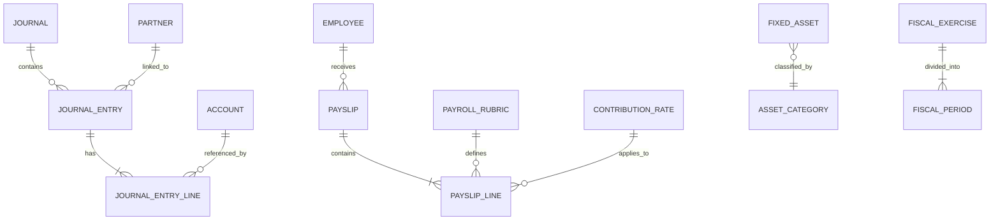

# Phase 3 — MCD & MCT (Modèles Conceptuels)

## Modèle Conceptuel de Données (MCD)

### Méthode
Utiliser la méthode MERISE adaptée pour ERP OHADA :

1. **Identifier les entités** depuis les SFG (chaque nom propre récurrent = entité candidate)
2. **Définir les associations** avec cardinalités (1,1 / 0,n / 1,n / n,m)
3. **Attributer les propriétés** à chaque entité
4. **Identifier les identifiants** naturels et techniques

### Entités de référence JASPE (31 minimum)

```
Schéma common (partagé) :
  companies, currencies, exchange_rates, fiscal_years, fiscal_periods,
  users, roles, permissions, audit_log, sequences,
  ohada_account_templates, tax_rates, country_config, notification_templates

Schéma client_demo (par tenant) :
  accounts, journals, journal_entries, journal_entry_lines,
  partners, partner_contacts,
  employees, payroll_runs, payslips, payslip_lines,
  fixed_assets, depreciation_schedules,
  bank_accounts, bank_transactions, bank_reconciliations,
  tax_returns
```

### Tables de paramétrage (11 tables critiques)

```
Paie (8) : payroll_rubrics, contribution_rates, payroll_variables,
           pay_periods, absence_types, absences, leave_balances, payroll_cumuls
Immobilisations (1) : asset_categories
Comptabilité (2) : reconciliation_groups, fiscal_exercises
```

Sans ces tables, les fonctions RPC utilisent des constantes codées en dur → non maintenable.

### Conventions de nommage
- Tables : snake_case, pluriel anglais (`journal_entries`, pas `ecriture`)
- Colonnes : snake_case (`account_number`, `base_salary`)
- FK : `[table_referenced]_id` (`journal_id`, `employee_id`)
- Enum : UPPER_CASE (`POSTED`, `DRAFT`, `ACTIVE`)
- Timestamps : `created_at`, `updated_at` (automatiques via triggers)

### Diagramme
Produire en Mermaid erDiagram :



---

## Modèle Conceptuel de Traitements (MCT)

### Méthode
Pour chaque cas d'usage du SFG, modéliser le traitement :

1. **Événement déclencheur** : action utilisateur ou système
2. **Opération** : traitement métier (avec règles de gestion)
3. **Synchronisation** : conditions de déclenchement (ET/OU)
4. **Résultats** : événements produits (succès/échec)

### Catalogue des traitements JASPE

```
T1  : Création écriture comptable     → rpc_create_journal_entry
T2  : Validation écriture             → rpc_validate_journal_entry
T3  : Lettrage automatique            → rpc_auto_lettrage
T4  : Rapprochement bancaire          → rpc_auto_reconcile_bank
T5  : Calcul de la paie               → rpc_calculate_payroll
T6  : Validation bulletin             → rpc_validate_payslip
T7  : Génération OD de paie           → rpc_generate_payroll_entries
T8  : Calcul amortissements           → rpc_generate_depreciation
T9  : Déclaration TVA                 → rpc_generate_tva_declaration
T10 : Clôture période                 → rpc_close_fiscal_period
T11 : Prévision trésorerie            → rpc_cash_forecast
T12 : Ratios financiers               → rpc_financial_ratios
T13 : KPI tableau de bord             → rpc_dashboard_kpi
```

### Règle de classification UI
- **Traitement simple** (1 table, CRUD) → SmartGrid gère seul
- **Traitement complexe** (multi-tables, règles métier, batch) → Fonction RPC PostgreSQL
- **Critère décisif** : si le traitement nécessite une transaction atomique sur 2+ tables → RPC obligatoire

### Matrice de traçabilité
Chaque traitement MCT doit être tracé vers :
- Le(s) cas d'usage SFG correspondant(s)
- La(les) règle(s) métier appliquée(s)
- La fonction RPC d'implémentation
- Le(s) composant(s) UI déclencheur(s)
